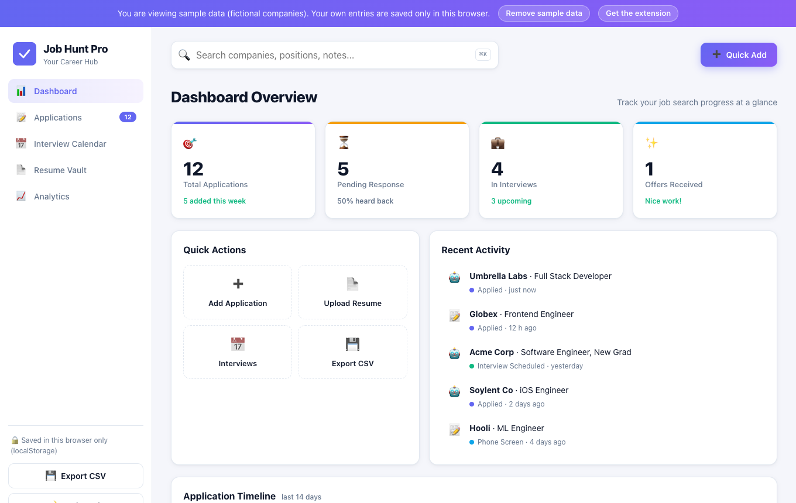
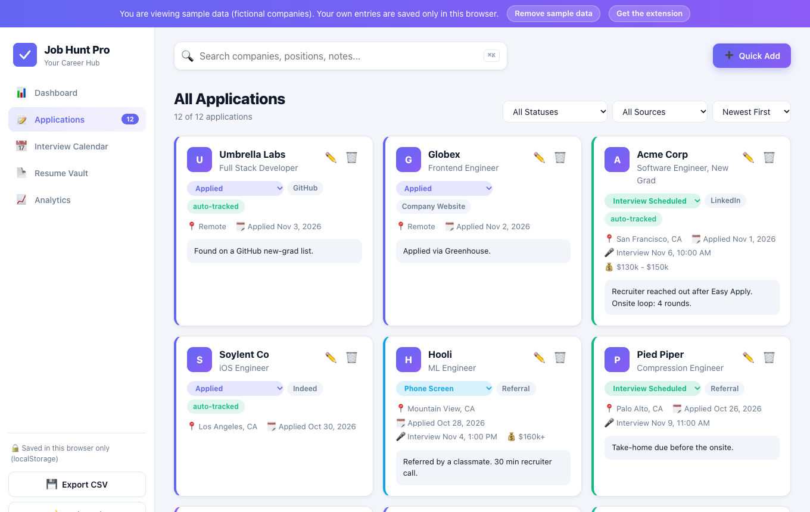
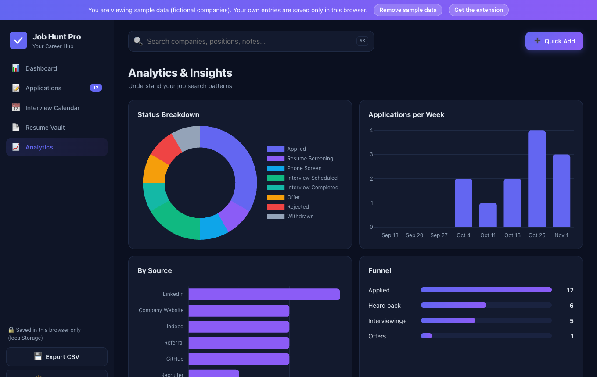
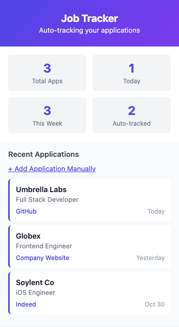

# Job Hunt Pro: Job Application Tracker

> A free Chrome extension that records each job you apply to (LinkedIn, Indeed, GitHub job lists, Greenhouse, Lever and more) and a private dashboard to track status, interviews and resumes. All data stays on your device.

[](https://kush-job-application-tracker.netlify.app/app/)
[](https://github.com/KushagraKanaujia/job-application-tracker/releases/latest)
[](https://kush-job-application-tracker.netlify.app/)
[](LICENSE)



## Try it in one click

| What | Link | Needs |
|---|---|---|
| **Live dashboard demo** | [kush-job-application-tracker.netlify.app/app](https://kush-job-application-tracker.netlify.app/app/) | Nothing. Opens with sample data (fictional companies); what you add is saved only in your browser. |
| **Install the extension** | [Latest release (.zip)](https://github.com/KushagraKanaujia/job-application-tracker/releases/latest) or [direct download](https://kush-job-application-tracker.netlify.app/download/job-application-tracker-extension.zip) | Chrome (or any Chromium browser). |
| **Project website** | [kush-job-application-tracker.netlify.app](https://kush-job-application-tracker.netlify.app/) | Nothing. |

### Install the extension in 3 steps

1. **Download** the zip above and unzip it into a folder you will keep.
2. Open **`chrome://extensions`** and switch on **Developer mode** (top-right).
3. Click **Load unpacked**, pick the unzipped folder, and pin the extension. The dashboard opens automatically.

From then on, apply to jobs as usual. When the extension spots an application it shows a small green "Job application tracked!" note on the page and adds it to your list.

## What it does

- **Auto-tracking**: the content script watches job pages for application submits and "Apply" clicks, extracts company, role, location and URL, and saves it. The same company and role within 7 days is treated as a duplicate.
- **Popup**: counts (total / today / this week / auto-tracked), the 5 latest applications, a manual-add form, CSV export, and a button to open the full dashboard.
- **Dashboard** (ships inside the extension, and also runs as a plain web page):
  - Stats, recent activity and a 14-day timeline
  - Applications list with search (⌘K / Ctrl+K), status and source filters, sorting, and one-click status changes
  - Add / edit / delete, with salary, notes, job URL, applied date and interview date
  - **Interview calendar**: upcoming and past interviews in order
  - **Resume vault**: keep resume versions in the browser (IndexedDB, max 5 MB each)
  - **Analytics**: status breakdown, applications per week, sources, response funnel
  - Dark mode and CSV export
- **Private**: no server, no account, no analytics. Extension data lives in `chrome.storage.local`; the web demo uses `localStorage`.

| Applications | Analytics (dark) | Popup |
|---|---|---|
|  |  |  |

### Supported sites

| Site | Detection |
|---|---|
| LinkedIn, Indeed, Greenhouse, Lever, ZipRecruiter, Dice | Site-specific extractors |
| GitHub job lists (e.g. SimplifyJobs-style tables) | "Apply" link clicks inside table rows |
| Glassdoor, Workable, SmartRecruiters | Generic (page title + site name) |

Job sites change their markup often, so a detector can miss. You can always add or fix an entry by hand. See [docs/PLATFORM_GUIDE.md](docs/PLATFORM_GUIDE.md) to add a site.

## How it works

```
job site page ──► content.js ──message──► background.js ──► chrome.storage.local
 (LinkedIn, ...)   reads the posting       dedupes + saves        │
                                                                   ▼
                                   popup.html  +  dashboard/index.html (live via storage.onChanged)
```

- `chrome-extension/content.js` runs only on the sites listed in `manifest.json`.
- `chrome-extension/background.js` (MV3 service worker) validates, dedupes and stores, then shows a Chrome notification.
- `chrome-extension/dashboard/` is the full app. Inside the extension it uses `chrome.storage`; opened as a normal web page it falls back to `localStorage` and offers sample data. It has no inline scripts and no remote code, so it meets the MV3 content security policy.

## Tech stack

- Vanilla JavaScript, HTML and CSS (no framework, no build step needed to run)
- Chrome Extension Manifest V3 (permissions: `storage`, `notifications`)
- [Chart.js](https://www.chartjs.org/) 4.4.7, bundled locally for the analytics view
- Netlify (free tier) for the static demo and landing page

## Run locally

```bash
git clone https://github.com/KushagraKanaujia/job-application-tracker.git
cd job-application-tracker

# Extension: chrome://extensions -> Developer mode -> Load unpacked -> select ./chrome-extension

# Dashboard as a web page (sample data loads on first visit):
python3 -m http.server 8000 --directory chrome-extension/dashboard
# then open http://localhost:8000/?demo=1
```

Build scripts (need `zip` and Node, used only for packaging):

```bash
bash scripts/package-extension.sh   # -> dist/job-application-tracker-extension-v<version>.zip
bash scripts/build-site.sh          # -> dist/site (landing page + /app demo + /download zip)
```

More guides: [QUICK_START.md](QUICK_START.md) · [EXTENSION_INSTALL.md](EXTENSION_INSTALL.md) · [docs/FAQ.md](docs/FAQ.md) · [docs/TROUBLESHOOTING.md](docs/TROUBLESHOOTING.md) · [docs/PRIVACY.md](docs/PRIVACY.md)

## Project layout

```
chrome-extension/
  manifest.json      MV3 manifest
  content.js         per-site detectors
  background.js      storage, dedupe, notifications
  popup.html/.js     toolbar popup
  dashboard/         full dashboard (also deployed as the live demo)
    vendor/chart.umd.min.js
site/                landing page source
scripts/             package + site build scripts
docs/                guides and screenshots
```

## Roadmap ideas

- CSV import
- Follow-up reminders ("no reply after 2 weeks")
- Firefox build
- More site-specific extractors (Workable, SmartRecruiters, Glassdoor)

## Contributing

Issues and PRs are welcome, especially new or fixed site detectors. See [CONTRIBUTING.md](CONTRIBUTING.md).

## Credits

- [Chart.js](https://github.com/chartjs/Chart.js) (MIT): charts in the Analytics view, vendored at `chrome-extension/dashboard/vendor/chart.umd.min.js` with its license header intact.
- [shields.io](https://shields.io) badges.
- Sample data in the demo uses fictional company names only.

## License

[MIT](LICENSE)
